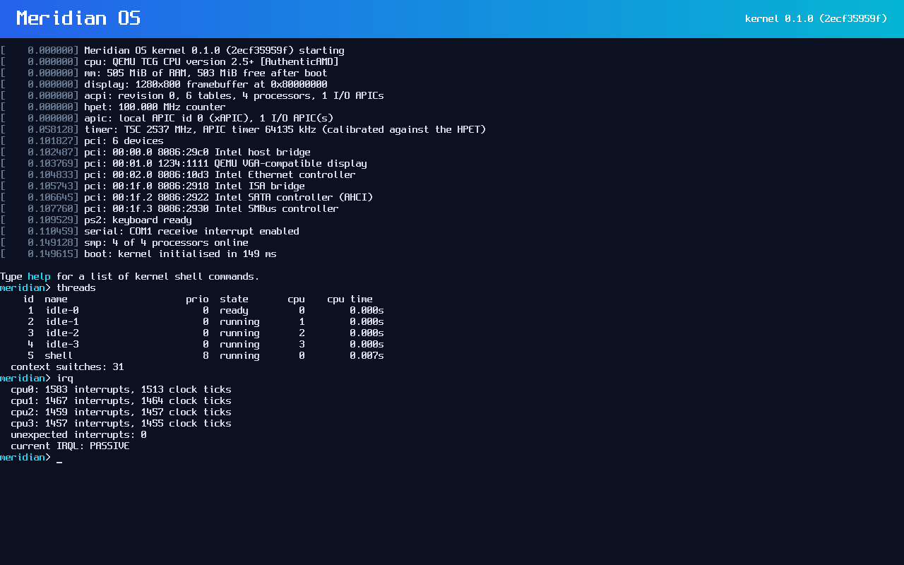

# Meridian OS

Meridian is an independently developed PC operating system with its **own
hybrid kernel** (inspired by the Windows NT architecture, written from scratch
in Rust). The long-term goal is an OS that feels familiar to Windows users,
runs real Windows applications and games through a native compatibility
subsystem, is as customisable as Linux, and never shows ads or collects
telemetry.

It is **not** a Linux distribution, not a Windows derivative and not a themed
desktop on top of another OS. Every line of the kernel is original.



## Status: early kernel (pre-alpha)

Meridian is at the very beginning of a long road. What exists today, all
tested on every commit in QEMU with UEFI firmware:

| Area | Status |
|------|--------|
| UEFI boot manager (own code, no third-party loader) | ✅ working |
| 64-bit higher-half kernel, NX/SMEP/SMAP/UMIP, guard pages | ✅ working |
| Physical memory manager, page tables, kernel heap | ✅ working |
| GDT/TSS/IDT, exceptions, recoverable fault probes, stop screen | ✅ working |
| ACPI tables (MADT, FADT, HPET, MCFG), local + I/O APIC, IRQL via CR8 | ✅ working |
| HPET/PIT-calibrated TSC and APIC timers, 1 kHz clock | ✅ working |
| PCI enumeration, PS/2 keyboard, serial console, framebuffer console | ✅ working |
| Kernel debug shell, ACPI reboot/power-off | ✅ working (QEMU) |
| Kernel threads, 32-level preemptive scheduler, DPCs | ✅ working |
| Events, semaphores, mutexes, timed waits, sleep | ✅ working |
| Multiprocessor: all cores started, IPIs, TLB shootdown, multicore scheduling | ✅ working |
| User mode: isolated processes, system calls, handles, PE32+ loader | ✅ working (first native program runs) |
| Storage drivers and filesystems | 🚧 next |
| Win32 subsystem, desktop, networking, GPU… | 📋 planned |

The first user-mode program (`init.exe`, a PE32+ executable built from
`system/init`) runs in ring 3 at every boot; a program that crashes is
terminated without affecting the kernel. Nothing runs Windows applications
yet (the Win32 subsystem does not exist), there is no desktop yet, and no real
hardware has been tested yet. See [docs/STATUS.md](docs/STATUS.md) for the
precise feature list, known bugs and test results, and
[docs/ROADMAP.md](docs/ROADMAP.md) for the plan.

## Try it

You need Rust (stable), Python 3 and QEMU. On Windows:

```bash
winget install SoftwareFreedomConservancy.QEMU
```

Then, on Windows, double-click **`run-meridian.cmd`** in the repository
folder (or run it from a terminal). Anywhere else, run:

```bash
python tools/mbuild.py run --release
```

That builds the boot manager, kernel and user programs, writes a bootable
GPT disk image to `build/meridian.img` and boots it in a QEMU window. Click
inside the window to type. Build output stays small (about 15 MB in
`target/` plus the 48 MB disk image) and `python tools/mbuild.py clean`
removes all of it. The kernel shell accepts
commands such as `help`, `cpu`, `mem`, `threads`, `ps`, `run init`, `pci`,
`acpi`, `uptime` and `shutdown`.

Run the automated kernel tests:

```bash
python tools/mbuild.py test
```

Full instructions: [docs/BUILDING.md](docs/BUILDING.md) and
[docs/TESTING.md](docs/TESTING.md). Meridian never installs itself anywhere:
the build only writes files inside `build/`.

## Principles

* **Original kernel.** No Linux, NT, BSD, ReactOS or macOS kernel code.
* **Windows-first.** Familiar desktop and real Windows application
  compatibility built on public documentation, never on leaked or copied
  Microsoft code.
* **Gaming is a first-class goal**, designed in from the kernel up.
* **No ads, no sponsored content, no hidden telemetry, no forced accounts.**
* **Honest status.** A feature is listed as working only when it is tested.

## Documentation

| Document | Contents |
|----------|----------|
| [ARCHITECTURE.md](docs/ARCHITECTURE.md) | System architecture and language choices |
| [KERNEL_DESIGN.md](docs/KERNEL_DESIGN.md) | Kernel internals: boot, memory, interrupts, IRQL |
| [BUILDING.md](docs/BUILDING.md) | Toolchain and build instructions |
| [TESTING.md](docs/TESTING.md) | Self tests, CI and how to add tests |
| [ROADMAP.md](docs/ROADMAP.md) | Development phases and milestones |
| [STATUS.md](docs/STATUS.md) | Completed features, known bugs and limitations |
| [WINDOWS_COMPATIBILITY.md](docs/WINDOWS_COMPATIBILITY.md) | Windows compatibility plan |
| [GAMING_COMPATIBILITY.md](docs/GAMING_COMPATIBILITY.md) | Graphics, DirectX, Steam and anti-cheat plan |
| [HARDWARE_SUPPORT.md](docs/HARDWARE_SUPPORT.md) | Tested hardware and driver plan |
| [SECURITY.md](docs/SECURITY.md) | Security model and how to report issues |
| [TROUBLESHOOTING.md](docs/TROUBLESHOOTING.md) | Common problems |
| [LICENSES.md](docs/LICENSES.md) | Licences of Meridian and bundled components |
| [CONTRIBUTING.md](CONTRIBUTING.md) | How to contribute |

## Licence

Meridian OS is licensed under the [Apache License 2.0](LICENSE). Bundled
third-party assets keep their own licences; see [docs/LICENSES.md](docs/LICENSES.md).
Meridian is not affiliated with Microsoft. "Windows" is a trademark of
Microsoft Corporation and is used here only to describe compatibility goals.
